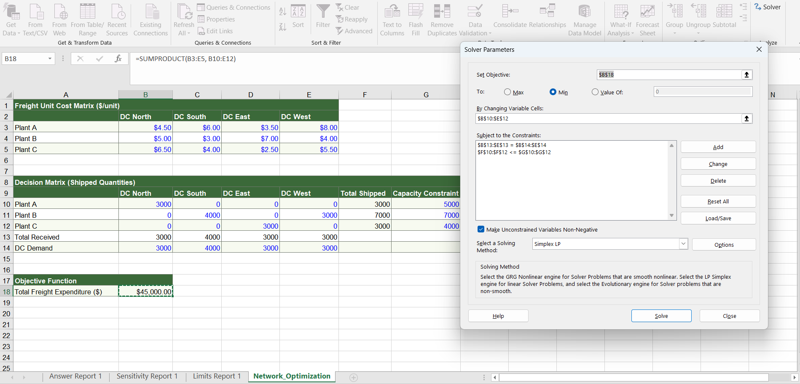

# 🌐 Logistics Network Freight Cost & Lane Optimization

## 📌 Executive Summary
This project utilizes **Operations Research (Linear Programming)** via **Microsoft Excel Solver** to optimize a multi-echelon distribution network. The model minimizes total freight transportation expenditure across 3 regional manufacturing plants and 4 distribution centers while strictly adhering to factory production capacities and 100% customer demand service-level agreements.

---

## 📊 Optimization Model & Solver Results

### Key Optimization Highlights:
* **Optimal Total Freight Cost:** Minimized total monthly transport expenditure down to **$45,000** by dynamically routing shipments through the most cost-efficient lanes.
* **Capacity Utilization:** Balanced production allocation across Plant A (5,000 units), Plant B (7,000 units), and Plant C (4,000 units) without violating upper-bound constraints.
* **Demand Fulfillment:** Achieved 100% fulfillment across all regional demand nodes (DC North, South, East, and West).

---

## 🛠️ Methodology & Technical Stack
* **Tool:** Microsoft Excel (Solver Add-in, Simplex LP Algorithm).
* **Mathematical Components:**
  * **Objective Function:** Minimize Total Freight Expenditure via `=SUMPRODUCT(Cost_Matrix, Allocation_Matrix)`.
  * **Constraints:** Plant Total Shipped $\le$ Factory Capacities; DC Total Received $=$ Customer Demands; Non-negativity constraints ($\ge 0$).

---

## 💡 Strategic Recommendations
1. **Lane Rationalization:** Prioritize long-term volume contracts on high-efficiency lanes identified by the model (such as low-cost regional pairings).
2. **Capacity Rebalancing:** Evaluate expanding production at lower-cost manufacturing nodes to absorb future demand spikes and further drive down per-unit freight costs.
